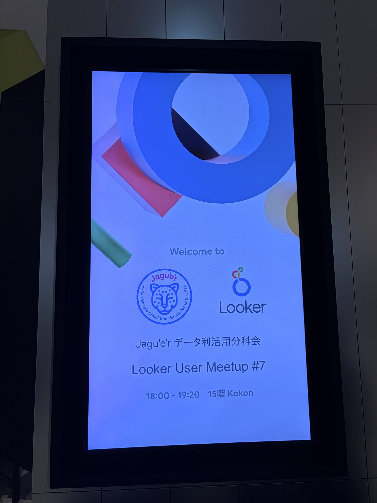
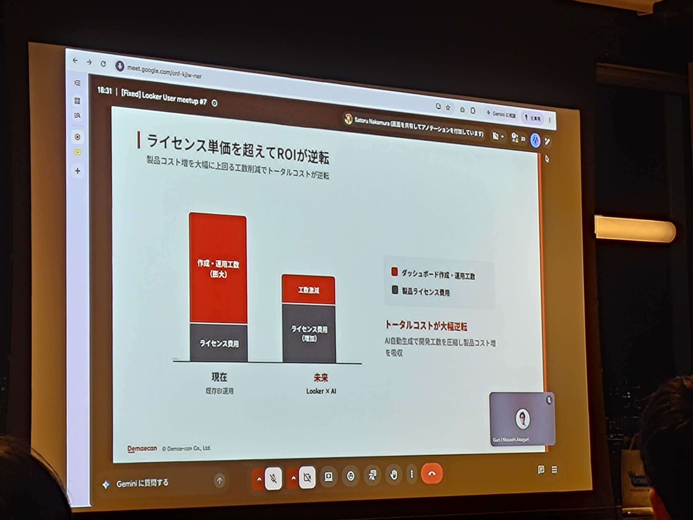
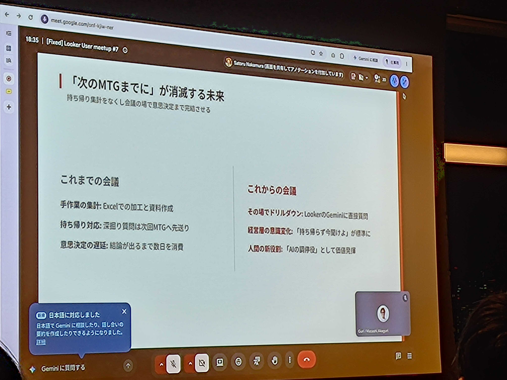
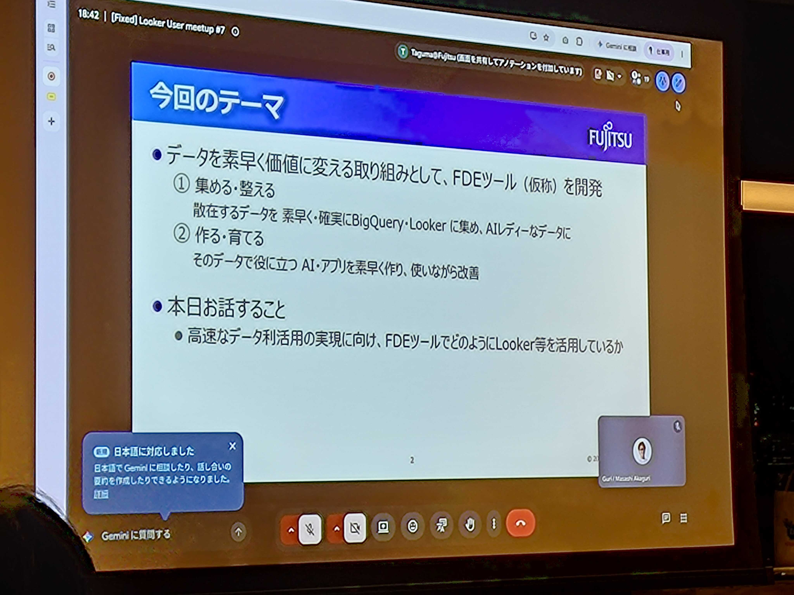
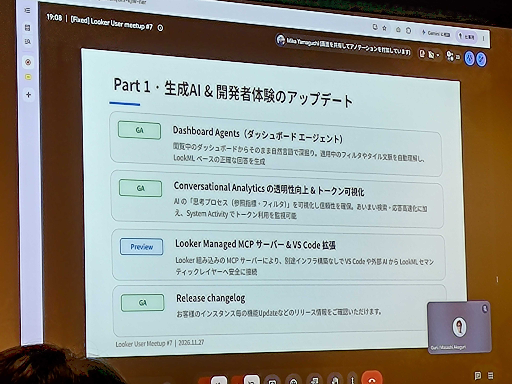
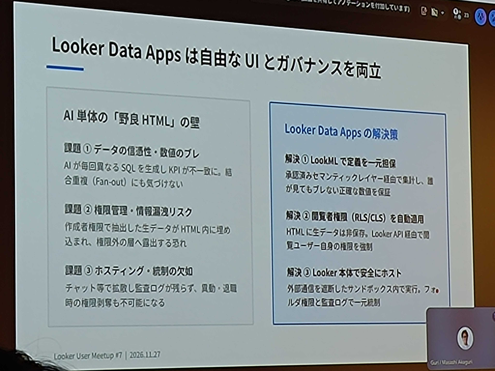

## 1. はじめに

株式会社 MBK デジタルの古畑です。

2026 年 11 月 27 日 (金) に Google 渋谷オフィスで開催された、Jagu'e'r（Japan Google Cloud Usergroup for Enterprise）データ利活用分科会主催の「Looker User Meetup #7」に参加してきました。

当日は出前館様、富士通様、Google Cloud 様の 3 社から LT があり、軽食や飲み物を片手に話を聞くカジュアルな雰囲気の会でした。
全体を通して話題になっていたのは、AI が SQL や UI を当たり前のように作れるようになった今、LookML をはじめとしたセマンティックレイヤーをどう作り、どう運用していくかという点です。

この記事では、3 つの LT の内容を振り返りつつ、開会前に会場で同卓の方と話したメタデータ整備の難しさも交えて所感をまとめます。

:::message
本記事の内容は、当日の講演をもとにした個人の理解と所感です。
本イベントはフルオープン形式で開催されており、ブログや SNS での発信が推奨されています。
:::

## 2. イベント概要

Jagu'e'r は Google Cloud のユーザー会で、データ利活用分科会ではデータ基盤や BI に関する事例共有や意見交換を行っています。

| 項目 | 内容 |
| :--- | :--- |
| 開催日 | 2026 年 11 月 27 日 (金) 18:00 - 19:20（懇親会 19:20 - 19:50） |
| 会場 | Google 渋谷オフィス（渋谷ストリーム）／オンライン配信（ハイブリッド） |
| 主催 | Jagu'e'r データ利活用分科会 |
| 登壇 | 出前館様、富士通様、Google Cloud 山口様 |
| ハッシュタグ | `#Jaguer` `#lookermeetup` |

## 3. LT 1：出前館様「Looker 採用のリアルと AI 時代のデータ活用」

1 本目は、株式会社出前館でデータ基盤部部長を務める中村様の LT です。
BigQuery の Google Developer Expert としても長く活動されている方で、なんと 12 月 1 日から Looker の契約を始める直前というタイミングで、導入に至るまでの本音と稟議を通した流れを赤裸々に話していただきました。

### 導入前の本音と、既存 BI の Excel 問題

フードデリバリーの注文データや行動データを BigQuery で扱っている出前館様ですが、もともと Looker を入れる気はまったくなかったそうです。
ライセンス費用の高さに加え、LookML を覚えて書く手間もネックになっていました。
Google が提唱している YAML ベースのオントロジー管理規格「OKF（Open Knowledge Format）」を Git 管理すればポータビリティも高く、AI にも読ませやすいので、それで十分ではないかと考えていたとのことです。

一方で、社内の既存 BI 運用には別の限界が来ていました。
ダッシュボード作成が一部の担当者しかできない「職人芸」になってしまい、現場からの依頼がさばききれない状態に。

その結果、現場がデータをローカルに落として Excel で加工し、PowerPoint に貼って報告する運用が広がってしまいました。
手で触った Excel の数字は信用できず、コンプライアンス面でもまずいため、とにかく Excel での加工をなくしたいという問題意識が強かったそうです。

### 「LookML を書くコストは AI でほぼゼロになる」という気づき

状況が変わったのは、1 年かけて整備した BigQuery のテーブルディスクリプションやリネージ情報を、Gemini を使って OKF に自動出力したときでした。
これを見て「LookML も同じように AI に書かせれば、作成コストはほぼゼロにできるのでは」と気づいたそうです。

公開しているマートテーブルは 50 テーブルほどで、この規模なら AI を使えば短時間で LookML 化できます。
さらに、Looker は API やコードベースで扱えるため、マーケティング施策などを考えるときに AI と KPI を壁打ちし、そのまま自然言語でダッシュボードを作って修正する運用が見えてきました。

依頼待ちがなくなり、ミーティングの場でグラフを直して深掘りできるなら、ライセンス単価が上がってもトータルコストは下がる。
そう試算して経営層に持っていったところ、その場で導入が決まったとのことです。

### 12 月からの運用方針：「全員 Developer」と「AI の調停役」

これから始める運用方針もかなり割り切っていました。

- OKF を SSOT（Single Source of Truth）として管理し、そこから LookML の生成やナレッジカタログへの連携を行う
- Explorer ライセンスは入れず、Viewer と Developer に絞る。
    - アナリストなどには全員 Developer ライセンスを配り、自然言語と Git 管理で自由に LookML やダッシュボードを作ってもらう
- 似たような LookML があちこちにできても、あとから AI に探させて統合し、参照しているダッシュボードもまとめて書き換えさせればいい。
    - 最初から完璧なセマンティックレイヤーを固めようとしすぎない
- データ基盤チームの役割は「AI の調停役」。
    - 売上に消費税を入れるかどうかといったビジネス定義を人間がジャッジし、LookML やナレッジカタログに返していく

質疑応答では BigQuery の会話分析（Conversational Analytics）との使い分けも話題になりました。
併用は考えているものの、BigQuery 単体やスプレッドシートの生成機能だけではダッシュボードが乱立し、数字の定義もバラバラになりやすい。
ガバナンスと定義統一のために Looker とナレッジカタログを使う、という整理でした。

## 4. LT 2：富士通様「FDE ツールによるデータパイプライン・アプリ自動構築」

2 本目は、オンラインで登壇された富士通様のセッションです。
顧客の現場に入って短期間で動くものを作り、フィードバックを受けながら直していく FDE（Forward Deployed Engineer）の取り組みと、それを支える「FDE ツール」のデモを見せていただきました。

散在した企業データを価値に変えるには、まず AI がそのまま使える状態にデータを整え、実際のデータで動くアプリを早い段階でユーザーに触ってもらうサイクルが欠かせません。
ただ、これを毎回手組みでやると時間がかかりすぎます。
FDE ツールは、Google Cloud のインフラや生成 AI に富士通様のベストプラクティスを組み合わせ、要件定義からパイプライン構築、セマンティックレイヤー整備、アプリ生成までを一気に進める仕組みになっているとのことでした。

### デモ①：メダリオンアーキテクチャと LookML の自動生成

開発側のデモでは、対話形式でデータ基盤が組み上がっていく流れが紹介されました。

1. Cloud Storage に置かれたデータを BigQuery に取り込む
2. 要件定義をもとに、Bronze → Silver → Gold のメダリオンアーキテクチャに沿ったパイプラインを AI が自動で設計・構築する
3. Gold 層のデータに対し、Looker（LookML）でテーブル間のリレーションやディメンション・メジャーを自動定義する

### デモ②：在庫最適化アプリと書き戻し（Write-back）

続いて、整えたセマンティックレイヤーと生成 AI エージェントを組み合わせて生成した在庫最適化アプリのデモがありました。

世界各地の拠点ごとの在庫切れ予測や需要予測が時系列で可視化され、マイナスの推移からどれくらい機会損失が出そうか一目で分かる画面になっています。
さらに地図上で在庫が余っている拠点と足りない拠点を確認し、拠点間の移管量を画面上でシミュレーションできます。

面白かったのは、シミュレーションで決めた移管量を Cloud Functions 経由でデータベースに書き戻し、実際の在庫移管の業務プロセスまで動かしている点です。
細かいアクセス制御にも対応しており、ダッシュボードを見て終わりにせず、意思決定からアクションまで一気につなげる具体例になっていました。

## 5. LT 3：Google Cloud 山口様「Looker 最新アップデート 2026」

3 本目は、Google Cloud の山口様から 2026 年の Looker 最新アップデートの紹介がありました。

2026 年の Looker は、従来の「ダッシュボードを見る BI」から、AI と対話しながら次のアクションにつなげる「Agentic BI（エージェント型 BI）」へ大きく舵を切っています。
その土台にあるのは、引き続き LookML によるセマンティックレイヤーです。

当日紹介された主な機能は以下の通りです。

| 機能名 | 概要 |
| :--- | :--- |
| **Dashboard Agent** | 有効化するとダッシュボード上に Gemini アイコンが表示され、自然言語で売上変動の要因などを深掘りできる。画面でかけたフィルター条件も引き継いで回答する。 |
| **Conversational Analytics（会話分析）** | AI がどのフィールドやフィルターを使って計算したかの思考プロセスが表示されるようになり、応答速度や曖昧さの解消も改善。System Activity からトークン消費量・質問内容・レイテンシを確認できる。 |
| **Looker マネージド MCP サーバー** | デベロッパー向け機能。Looker の外に自前で MCP サーバーを立てなくても、Looker ホステッドの MCP サーバーをそのまま使える。 |
| **リリース変更履歴機能** | 利用中のインスタンス種別に応じて、毎月の変更内容や近日提供予定の機能をインラインで確認できる。 |
| **Looker Data Apps** | 2026 年 10 月にパブリックプレビューになった新機能（詳細は後述）。 |

なお、会話分析のトークン利用については、インスタンスのコアユーザー数に応じた無償枠が設けられており、**2027 年 2 月から無償枠を超えた分に対して有償課金が始まる予定** との案内がありました。

### 注目機能「Looker Data Apps」

今回のメインとして紹介されたのが、パブリックプレビュー中の **Looker Data Apps** です。

生成 AI を使えば HTML で自由度の高い UI をすぐ作れるようになりましたが、そのまま現場に配ると「AI が毎回 SQL を書くせいで数字がズレる」「機密情報が UI に埋め込まれる」「管理されていない野良アプリが増える」といった問題が起きがちです。

Looker Data Apps は、AI による柔軟なカスタム UI 生成と、裏側での Looker セマンティックレイヤー接続を両立する仕組みです。
個人のアクセス権限やガバナンスが効いたまま、Looker 本体にホステッドダッシュボードとして公開できます。

デモ動画では、2〜3 行の短いプロンプトから航空会社向けのダッシュボードを作る様子が流れました。
公式手順通りに進めればセットアップは 10〜15 分、全体でも 25〜30 分ほどでプレビューから公開までたどり着けるとのことで、非エンジニアでも手を出しやすそうでした。

## 6. 会場での会話と参加しての所感

### 開会前に話した「Bronze から Silver の壁」

実はイベントが始まる前、会場で同じテーブルだった方と「メタデータ整備って結局どこが一番つらいのか」という話をしていました。

メダリオンアーキテクチャで言うと、システムデータをそのまま入れる Bronze 層まではわりと作れます。
ただ、その先の **Bronze から Silver へデータを整え、メタデータをつけるところで止まってしまう** 企業が本当に多いです。

現場でありがちなのが、エンジニアは「業務のことは現場しか分からないから現場がやってくれ」と言い、現場は「データの話だからエンジニアがやってくれ」と押し付け合うパターンです。
通常業務の片手間でやろうとするとどうしても後回しになって、そのまま進まなくなってしまいます。

最近は AI を使えば、テーブルの中身やカラム名から説明文の叩き台を「それっぽく」作ることはできます。でも、**「それっぽい」と「正しい」はまったくの別物** です。

たとえば売上ひとつとっても、税込なのか税抜なのか、キャンセルをキャンセル時点で消し込むのか購入時点まで遡るのかは会社ごとのルールがあります。
`sales` というカラムにただ「売上」と書いてあっても、実務ではほとんど役に立ちません。

最初から完璧な仕様書を用意しようとすると動けなくなるので、まずは AI の推測で叩き台を入れて分析を回してみる。
出てきた結果に対して業務部門から「いつも見ている数字となんか違う」と違和感をもらって、そこから定義を直していく。
結局そういう泥臭い進め方が一番現実的だよね、という話になりました。

### 3 つの LT を聞いて思ったこと

そんな話をした直後に 3 つの LT を聞いたので、話がすっと頭に入ってきました。

AI モデルの性能自体はこれからも勝手に上がっていきますが、土台のメタデータやセマンティックレイヤーが曖昧なままだと、どれだけ賢い AI をつないでもまともな答えは返ってきません。
その一方で、今回の 3 つの発表を見ていて感じたのは、LookML の記述やパイプライン構築、UI 作成といった手を動かす部分は AI に任せて、人間は「数字の定義をどう決めるか」「実データを見て業務に合うか判断する」ところに寄せていく動きです。

特に、出前館様が話されていた **「AI の調停役」** という言葉は、これからのデータチームの役割をうまく言い表しているなと思いました。
データ基盤の支援をする側としても、最初の Bronze から Silver をどう立ち上げるか、AI が作ったものを人間がどう調停して回していくか。このあたりを仕組みにしていくことが、これからますます大事になりそうです。

## 7. 次回イベントのご案内

Jagu'e'r データ利活用分科会では、2026 年の締めくくりとして **12 月 9 日 (水)** に **「【#37】データ基盤 開発・構築の体験談（苦労話・しくじり話）」** が開催予定です。

「Datastream 経由で BigQuery のコストが爆発した話」や「ADK によるエージェント開発の苦労話」など、リアルな体験談やしくじり座談会が予定されています。
興味のある方はぜひチェックしてみてください。

| 項目 | 内容 |
| :--- | :--- |
| 開催日 | 2026 年 12 月 9 日 (水) 17:30 - 19:35（受付 17:00〜 ／ 懇親会 19:35 - 21:00） |
| 会場 | Google 渋谷オフィス（渋谷ストリーム）／オンライン配信（ハイブリッド） |
| 内容 | 事例セッション（株式会社 Hajimari 様、株式会社 FLUX 様）、LT × 3 本（神田外語大学様、株式会社電通デジタル様、株式会社スリーシェイク様）、しくじり座談会、懇親会 |
| 申込フォーム | [Jagu'e'r データ利活用分科会 #37 申込フォーム](https://forms.gle/jTarfDQtvHzWLkDz9) |

`#Jaguer` `#lookermeetup`