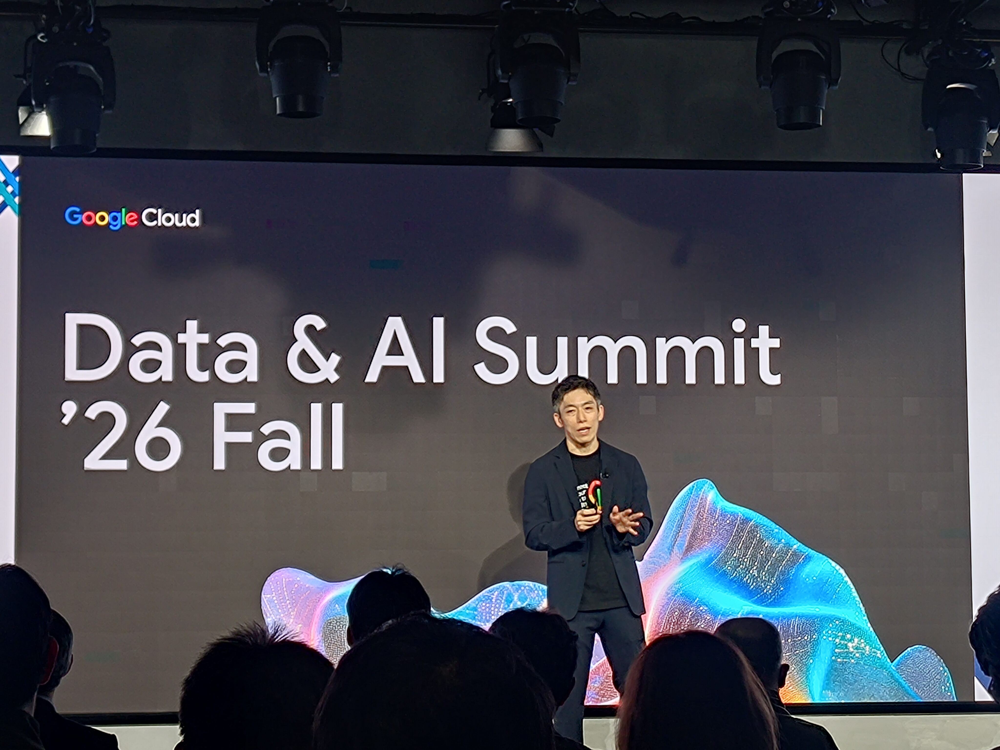
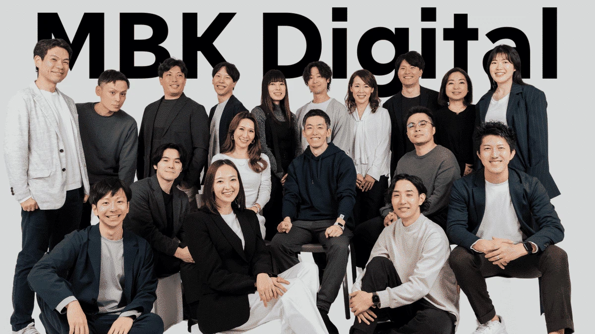

## 1. はじめに

株式会社 MBK デジタルの古畑です。

2026 年 11 月 18 日 (水) に Google 渋谷オフィスで開催された、Google Cloud 主催の「Data & AI Summit ’26 Fall」に参加してきました。

今回は一般参加ではなく、午前中に開催されたハンズオン「【基礎編】その AI エージェント、業務で使える？ ― 回答の品質・速さ・費用を比べて構成を選ぶハンズオン」に、MBK デジタルの一員としてスタッフで参加しました。
弊社 CTO の岩尾が講師を務めたハンズオンで、私は会場を回りながら参加者の皆さんの操作をサポートする役回りです。そのまま午後の基調講演やセッションも聴講しました。

今年のイベントの一番のキーワードは **AI Economics** でした。
「AI エージェントを作れるか」ではなく、「作った AI エージェントを、品質・応答時間・費用に見合う形で業務に使い続けられるか」。
ハンズオンでも基調講演でもセッションでも、この問いが共通して語られていました。

本記事では、午前のハンズオンをスタッフ目線で振り返りつつ、午後の基調講演と、個人的に気になったセッションについて書きます。

:::message
本記事の内容は、当日の講演・公開資料・公開記事をもとにした個人の理解と所感です。
:::

## 2. Data & AI Summit ’26 Fall とは

### 概要

Data & AI Summit は、Google Cloud が主催するデータ・AI 領域のイベントです。
今回のテーマは「データ戦略の最適解、『Agentic Data Cloud』」。
データを「ためて分析する」基盤から、AI エージェントが「使って動く」基盤へ、という Google Cloud のメッセージのもと、BigQuery・Knowledge Catalog・Looker・AlloyDB などを使ったデータエージェントの事例や技術解説が並びました。

| 項目 | 内容 |
| --- | --- |
| 開催日 | 2026 年 11 月 18 日 (水) |
| 会場 | Google 渋谷オフィス／オンライン配信（ハイブリッド） |
| ハンズオン | 午前（現地参加者限定・抽選制） |
| カンファレンス | 13:00 - 18:15（基調講演 → 14:25 から 3 トラックのブレイクアウト） |
| 懇親会 | 18:30 - 19:30（現地参加者限定） |
| 会場定員 | 250 名（抽選制） |

https://cloudonair.withgoogle.com/events/data-ai-summit-26f

### 今年のキーワードは「System of Action」と「AI Economics」

イベント全体を通じて繰り返し出てきたのが、データ基盤の役割が **「System of Insight（分析して答えを出す）」から「System of Action（業務プロセスそのものを支える）」へ変わる** という話でした。

そしてもう一つが、トークン消費やインフラコストまで含めて「使い続けられるか」を考える **AI Economics** です。
弊社が担当したハンズオンや基調講演でも、この AI Economics が中心テーマになっていました。

## 3. 【午前】ハンズオンにスタッフとして参加して

### どんなハンズオンだったか

午前のハンズオンは、弊社 CTO の岩尾が講師を務めた「【基礎編】その AI エージェント、業務で使える？ ― 回答の品質・速さ・費用を比べて構成を選ぶハンズオン」です。
架空の EC 企業のデータを分析する AI エージェントを題材に、回答の品質・応答時間・費用を比べながら「AI にどの仕事まで、どう任せるか」を考える内容で、10 月の事前イベントと当日の 2 回構成になっていました。

会場に入ってまず驚いたのが、参加率の高さです。
抽選制で朝からの開催ということもあり、どれくらい来ていただけるか少し不安でしたが、嬉しい誤算でした。

最終的には 50 名ほどの方にご来場いただき、会議室 1 つには収まりきらず、2 会場に分かれての開催になりました。

### 参加者の熱量

始まってみると、皆さん手順書と画面を行き来しながら、最後まで本当に熱心に取り組まれていました。
「とりあえず課題を流して終わり」という雰囲気はまったくなく、どの席からも真剣さが伝わってきました。

スタッフとして一番うれしかったのは、質問の多さです。
エンジニアの方はもちろん、普段は Cloud Shell や Google Cloud のコンソールにあまり触れていなさそうな方からも、何度も声をかけていただきました。

「ここはどこを見ればいいですか？」という操作の質問から、「この結果はどう読めばいいんでしょう？」という一歩踏み込んだ質問まで、一つひとつ一緒に画面を見ながら進めていくのは、運営側としても手応えを感じる時間でした。
技術的なバックグラウンドに関わらず、「AI を業務でどう使うか」を自分ごととして考えている方が多いことがよく分かりました。

## 4. 【午後】基調講演：Agent-Ready 2.0 ― 理論から実践、その先へ

午後の基調講演は「Agent-Ready 2.0 ― 理論から実践、その先へ」をテーマに、Google Cloud、KDDI、富士通、そして弊社 MBK デジタルが登壇しました。

### Google Cloud：AI エージェント時代のデータ基盤

Google Cloud の濱田真氏からは、LLM や基盤モデルはユーザー企業から見ればコモディティ化していき、差がつくのはデータだ、という前提のもと、データ基盤の役割が「System of Insight」から「System of Action」へ変わるという話がありました。
そのうえで挙げられたのが次の 3 点です。

- **コンテキストレイヤー**：指標の定義（セマンティック）や業務知識・データ同士の関係（オントロジー）を、AI が理解できる形で整備する
- **データを集約しない連携**：分散したデータを移さずに AI エージェントとつなぐ
- **AI Economics**：トークン価格だけでなく、データ基盤側の処理コストまで含めて全体最適を考える

### KDDI：泥臭い土台作りで集計時間を 94% 削減

KDDI の山中雅貴氏からは、Gemini を窓口に BigQuery で広告データを集計する仕組みで、1 案件あたり約 1.5 時間かかっていた集計を約 5 分（94% 削減）にした事例が紹介されました。
肝は Gemini そのものではなく、社内独自の用語の意味や集計方法を Knowledge Catalog に登録しておく「泥臭い土台作り」にある、という話でした。

### 富士通：AI を PoC で終わらせない FDE

富士通の森山伸昭氏からは、顧客の現場に入り込んで短期間で実物を作り、運用まで伴走する FDE（Forward Deployed Engineer）の取り組みが紹介されました。
電機メーカーの在庫調整業務で、2 週間でデータをつなぎ、2〜3 カ月単位でユースケースを広げていった結果、業務生産性 2 倍以上・100 億円近いキャッシュフロー改善につながったそうです。
根底にあるのは、「Real User」「Real Problem」「Real Data」から始める、というアプローチです。

### MBK デジタル：品質・応答時間・費用で決める AI Economics

弊社 CTO の岩尾は、「AI エージェントは当たり前に作れるようになった。では PoC を超えて本番導入へ進めるか」という問題意識から、品質・応答時間・費用を業務要件から考える AI Economics の事例を紹介しました。
キーメッセージは **「最も高性能な AI が、常に最適解とは限らない」** です。

紹介された 2 つの事例は、最適化の軸が対照的でした。

| 事例 | 業務の特徴 | 最適化の軸 | 選んだこと |
| --- | --- | --- | --- |
| 大手インフラ企業の VoC 分析 | 100 万件超の通話・即時性は不要 | AI 利用料 | 必要な品質を満たすモデル、Batch 処理、リージョン |
| 株主総会の回答支援 AI | 約 2,000 問を事前準備・当日は速さと確実性 | 人の作業工数 | 生成・評価は AI、最終承認は人。当日は承認済み Q&A のみ検索 |

VoC 分析では、業務要件から逆算してモデル・処理方式・リージョンを選び、必要条件を満たしたまま AI 利用料を基準構成比で約 88% 削減（試算）。
株主総会では、当日は新規生成せず承認済みの回答だけを素早く探す、という割り切りで確実性を担保していました。

業務が違えば最適化の軸も変わり、AI 利用料と人の工数を合わせて費用対効果で判断する。
午前のハンズオンと地続きのテーマで、イベント全体の軸がはっきり見えたパートでした。

### 聴講しての所感

正直に言うと、「AI エージェントにはデータが大事」「セマンティックレイヤーやオントロジーの整備が鍵」という話は、ここ 1 年ほどのイベントで繰り返し聞いてきたこともあり、少し食傷気味な気持ちで基調講演を聞き始めていました。
私自身、以前の LT で「AI 時代になってセマンティックレイヤーの価値はむしろ上がっている」と話した側の人間なので、その重要性に異論はまったくないのですが、メッセージとしては新鮮味が薄れつつある、というのが率直な感覚です。

そんな中で今回新しく感じたのが、**エコノミクスという軸が前面に出てきた**ことでした。
これまでの議論は「どうすれば AI が正しく答えられるか」という、いわば品質の話が中心でした。
今回はそこから一歩進んで、「正しく答えられるとして、それを品質・応答時間・費用に見合う形で使い続けられるか」が問われています。
Google Cloud の濱田氏がトークン価格だけでなくデータ基盤側の処理コストまで含めた全体最適を挙げ、岩尾が AI 利用料と人の工数を合わせて費用対効果で判断する事例を示したのは、その具体例です。

コンテキストレイヤーが「AI を動かす前提」なら、エコノミクスは「本番で使い続ける判断基準」と言えます。
PoC で動くものを作れるのが当たり前になったからこそ、次は業務要件に照らしてモデルや処理方式を選び、人がどこを確認するかまで含めて設計する。

データエンジニアとしても、「動くパイプラインを作る」だけでなく「その構成が費用に見合うかを説明できる」ことが、これからますます求められていくのだと思います。

## 5. 気になったセッション

基調講演のあとは、3 トラック並行のブレイクアウトセッションです。
その中から、個人的に気になった 3 つのセッションを取り上げます。

### データ移行なしで AI へ繋ぐ「SOAP」アーキテクチャ ─ オントロジーによるコンテキスト最適化とトークン消費の抑制

登壇：山田 雄 氏（Google Cloud データ アナリティクス スペシャリスト テックリード）

基調講演の最後に予告されていた「SOAP Architecture」を掘り下げるセッションです。
SOAP は Semantic and Ontology Agent Platform の略で、Google Cloud のデータ分析サービス群を「AI エージェントの基盤」として一枚の設計図にまとめたリファレンスアーキテクチャです。

全体は次の 3 層で構成されています。

| 層 | やること | 主なサービス |
| --- | --- | --- |
| つなぐ | データを移行せず、置いてある場所のまま BigQuery から分析する | Borderless Lakehouse、Cross-Cloud Interconnect |
| 意味を与える | 指標の定義や、業務上の実体（顧客・注文・商品など）とその関係を AI が読める形にする | LookML、BigQuery Graph、Knowledge Catalog、OKF |
| 働かせる | 意味を理解したエージェントが、ダッシュボードや自然言語の対話で利用者に応える | Conversational Analytics、Gemini Enterprise |

セッションのタイトルにもあるとおり、焦点は真ん中の「意味を与える」層、とくにオントロジーでした。
Knowledge Catalog が社内のドキュメントなども参照しながら、テーブルの意味や指標の背景、運用ナレッジを OKF（Open Knowledge Format、Markdown のバンドル）として生成し、Git で管理しながらエージェントに供給する。
テーブル同士の関係もグラフとして明示しておけば、エージェントが結合方法を推測する余地がなくなります。

**生データを丸ごと渡すのではなく、整理された知識だけをコンテキストに載せる** ことで、回答の精度を上げながらトークン消費も大きく抑えられる仕組みです。

個人的に面白かったのは、オントロジーの話が「精度のため」だけでなく「トークン消費を抑えるため」、つまりエコノミクスの文脈で語られていた点です。
基調講演の所感で「セマンティックやオントロジーの話は食傷気味だったが、エコノミクスで新しいフェーズに入った」と書きましたが、このセッションはまさに、その二つがつながる内容でした。

意味の層を丁寧に作ることが、そのまま品質とコストの両方に効いてくる。
データエンジニアとして、コンテキストレイヤーを整備する意義をあらためて言語化できた気がします。

SOAP の全体像は、Google Cloud の公式ブログでも解説されています。

https://cloud.google.com/blog/ja/products/ai-machine-learning/soap-architecture-turning-data-stored-in-s3-into-a-foundation-for-ai-agents-on-google-cloud

### 外食産業の事業成長を Data × AI で加速：Dinii の BigQuery と AI エージェント開発の試行錯誤とアーキテクチャ戦略

登壇：木村 純也 氏（株式会社ダイニー プロダクト本部 マネージャー）

外食産業向けに、予約・店内オペレーション・勤怠や経営管理・決済までを一体で提供する「オールインレストランクラウド」を展開するダイニーさんが、BigQuery のデータを扱う AI エージェントを社内向け・社外向けの 2 種類で作ってきた試行錯誤を紹介するセッションです。

目指しているのは、分析とアクションを 1 つのエージェントでつなぐ「Unified Agent」です。
たとえば「先週の客単価が下がったのはなぜ？」という質問に対して、常連客が減っていることを分析で示し、そのままチャット上で常連向けのクーポンまで作れる。
分析（System of Record）で終わらず、アクション（System of Action）まで一続きにするという発想は、基調講演の「System of Action」の話を具体的なプロダクトに落とし込んだ形だと感じました。

**誤答の影響が大きいほど、LLM に任せる範囲を狭くする**

データ基盤は AlloyDB → Datastream → BigQuery → Dataform でデータマートを作り、すべてのエージェントが同じデータマートを参照する構成です。
そのうえで、社内向けと社外向けでアーキテクチャを明確に分けています。
分岐点は「エージェントに SQL を書かせるかどうか」です。

| | 社内向けエージェント | 社外向けエージェント（プロダクト） |
| --- | --- | --- |
| 利用者 | 社内メンバー | 飲食店の経営者・店長 |
| 誤答の影響 | 小さい（おかしな結果に気づき、検証できる） | 大きい（データを見ない推測がそのまま判断に使われうる） |
| データの取り方 | LLM が SQL を書いて実行する | SQL は書かせず、バックエンドが公開する「ツール」を呼ぶ |
| 主なガードレール | 読み取り専用、ドライランによる課金上限、実行した SQL の常時開示、SQL を実行せずに数値を出す回答の機械的な排除 | 構造化されたクエリだけをバックエンドが発行、認可はエージェントサーバーとバックエンドで検証 |

社外向けでは、バックエンドのコントローラーにメタデータを付けて「ツールマニフェスト」として JSON 化し、エージェントサーバーのビルド時に読み込む仕組みにしているそうです。
LLM が直接データに触れない構造にすることで、でたらめな SQL が発行されるリスクそのものをなくしています。

**社外向けを成立させるための工夫**

ツール方式には、ツール選択の品質、入力トークンの肥大化、レイテンシという 3 つの課題があり、それぞれに打ち手が紹介されました。

- **ツール選択の品質**：似たツールを個別に定義せず、enum の引数を持つ 1 つのツールにまとめてメタデータを圧縮する。ツールを呼ばずに数値を答える、ツール結果にない数値を出す、呼んだふりをする、といったハルシネーションはコードで検出してエラーにする。さらに、Gemini のバージョンを上げた際に全体の質は上がったのに特定の質問だけ失敗するようになった経験から、モデルごとの癖を事前に洗い出して対策しておく
- **ナレッジグラフ**：売上＝客数×客単価、客単価＝点数×単価……といった外食 KPI の関係をグラフで管理し、関連をプロンプトとして機械的に渡す。アンケート結果の低下を売上の低下に直結させるような、飛躍した分析を防ぐ
- **入力トークンとレイテンシ**：ツールの説明文などを Gemini のコンテキストキャッシングに載せ、コスト・品質・応答速度を同時に改善する。待ち時間は処理の進捗をストリームで画面に出し、体感を変える

**品質保証はリリース前とリリース後で分ける**

リリース前は、PM やセールスも「この入力ならこの出力を期待する」を追加できるユースケース DB でベンチマークを取り、評価用 LLM は temperature 0 で揺れを抑えます。
リリース後は実際のチャットを採点する必要がありますが、LLM-as-a-Judge は評価が甘くなりがちなうえ、**採点のほうが回答生成よりコストがかかり、全件採点すると実際のチャット料金の 2 倍以上になる** という話は衝撃的でした。
そのため、LLM の採点に後から人の評価を当ててズレを評価の仕組みにフィードバックするサイクルを回し、採点自体をローカル LLM に逃がしてコストを下げる取り組みも進めているそうです。

評価はルーブリック形式で、軸ごとの点数に改善アクションを 1 つずつ対応させています（例：ツール選択の点数が低ければツールのメタデータを改善する）。
オブザーバビリティとしては、キャッシュヒット率、LLM コールのレイテンシ、入力トークン、出力に占める thinking の割合などを、変更の前後で同じ期間を比べてモニタリングしているとのことでした。
評価の仕組みを作る際の指針としては、Google Cloud が公開しているエージェント構築・運用のドキュメント（セッション内では「Agents Companion」として紹介）が挙げられていました。

**所感**

「誤答の影響が大きいほど LLM に任せる範囲を狭くする」という設計方針は、岩尾の株主総会の事例（当日は承認済みの回答だけを検索し、新規生成しない）とまったく同じ考え方で、用途ごとに AI の任せ方を変えることの重要性を別の角度から確かめられました。
ナレッジグラフも、まさにオントロジーを実プロダクトで運用している例です。

そして何より、コンテキストキャッシング、ローカル LLM による採点、キャッシュヒット率や入力トークンのモニタリングと、セッション全体を通してエコノミクスの視点が実装レベルまで落とし込まれていたのが見事でした。
「評価のほうが生成より高くつく」という話は、品質を担保するための仕組みそのものにもコストがかかる、というもう一段深い AI Economics の論点で、今回のイベントで一番の学びでした。

### Looker の会話分析をサブエージェントにしてアナリストと育てる社内分析 AI

登壇：北島 祥伍 氏（株式会社 MIXI デジタルエンターテインメントオペレーションズ本部 モンスト運営部 解析グループ 解析チーム データエンジニア）

『モンスターストライク』の社内 Slack で KPI や施策の結果を聞ける分析 AI ボットに、Looker の会話分析（Conversational Analytics）のデータエージェントをサブエージェントとして組み込んだ事例です。
開発はエンジニア 1 名と、マネージャーを含むアナリスト 4 名の体制です。
キーメッセージは、**Looker の会話分析には「ほどよい制約」と「作りやすさ」があるので、アナリストが自分でエージェントを作れるようになった**、というものです。

**精度と自由度の間を探す**

最初のボットは、人が 1 本ずつ書いてアナリストがレビューした固定 SQL の日付だけを AI が差し替える方式でした。
精度は担保できる一方で、答えられる質問が少なく広げにくい。
そこで逆に、テーブル情報や LookML を AI に渡して自由に SQL を書かせてみたところ、スキャン量の大きいクエリやテーブルの誤用が起き、ガイドを足し続ける対症療法に終わりが見えず、API 料金も高額になってしまいました。

原因として挙げられていたのが、長年の運用で積み上がった「この集計にはこのフィルターが必須」といった暗黙のコツと、ボットの利用者がデータ基盤で何を集計できるかを知らないという点です。
アナリストなら「それはコストがかかりすぎる」と断る依頼でも、AI は頑張って集計してしまう。
人に対してもそもそも Explore の権限はあまり渡さず、ダッシュボードを見てもらう運用をしていた、という話には深くうなずきました。

その間に位置づけられたのが Looker の会話分析です。
AI は Explore から項目（dimension・measure・filter）を選ぶだけで、SQL は LookML をもとに Looker が組み立てる。
だから **ダッシュボードと数字がずれない**。聞ける範囲は Explore に縛られますが、固定 SQL よりは格段に多くのことに答えられます。

**サブエージェントとしての組み込み方**

Slack のメンションを Cloud Run functions で受け、Cloud Tasks 経由で Cloud Run 上のオーケストレーター AI に渡す構成です。
オーケストレーターは、固定 SQL の KPI ツール群、施策情報の検索、Looker ダッシュボードの検索、そして会話分析エージェント群（売上やログインなどテーマ別に 21 種類）を使い分けます。

- **目的を絞ったエージェントにする**：1 エージェントに設定できる Explore は 5 つまでですが、何でも渡すと迷ったりコンテキストを圧迫したりするので、目的に合う Explore だけに絞る。大きすぎるエージェントは分割する
- **使わない項目を隠す**：会話分析には Explore の全項目（結合先の項目も含む）が毎回渡るため、トークン料金も上がる。項目を棚卸しして、ログインの Explore では 655 項目を 341 項目とほぼ半分に減らした
- **重い処理はオーケストレーター側に寄せる**：「前回のコラボガチャの初動は？」なら、まず施策情報を検索して期間を特定し、条件を具体的に絞ってから会話分析に聞く。大量のテキストを返す施策検索は会話分析側から外した
- **説明欄はオーケストレーターが読む前提で書く**：エージェントの名前と説明だけを見て呼び分けるので、目的とできることを丁寧に書く

**アナリストが自分で作れる仕組み**

固定 SQL 方式では、SQL はボットのコードの中にあり、直すにはエンジニアのデプロイが必要でした。
一方で、数字が正しいかを判断できるのはアナリストです。この分断を解消するために、エンジニアとアナリストがそれぞれ道具を用意しています。

エンジニア側は、YAML でエージェントを宣言してプルリクエストでレビューする仕組み、反映前に差分を確認できる Looker のエージェント用 CLI、名前に dev が付くエージェントはアナリストにしか見えない開発環境、ボット起動時に本番エージェントを自動で読み込む仕組みを用意。
アナリスト側は、テーマを決めて Explore を調査し、指示を書いて開発環境に反映するまでをコーディングエージェントと一緒に進めるためのスキルを作りました。
指示は「期間の指定がなければ聞き返す」「使ったフィルター条件を回答に書く」といった共通ルールと、Explore ごとのルールに部品化され、どれも実際にエージェントが間違えたことから書き起こされています。

結果として、7 月から 10 月にかけてアナリストから約 40 本のプルリクエストが出て、エンジニアはボット本体の改善に集中できるようになりました。

**運用してみて**

質問はまず固定 SQL、次に会話分析エージェント、それでも難しければダッシュボード検索、最後はアナリストへ、という順で扱われます。
ダッシュボードの URL を返すだけでなく、数字で答えられる質問が増えました。

面白かったのは、**AI のほうが人より LookML を使いこなしている** という話です。
人なら面倒がる多条件の集計も根気よく組み立て、あまり使われていなかった Explore の端の項目まで使って「そんな集計ができたのか」という答えを返してくる。

精度は、会話ログを監視用の Slack チャンネルに転送し、アナリストが Explore のリンクから集計を確認して OK/NG のリアクションを付け、必要ならエージェントを追加・修正する運用で担保しています。
オープンな Slack で聞けるので、ボットが答えられなかった質問に、アナリストより先に別の企画メンバーがダッシュボードを教えてくれた、というエピソードも面白かったです。

今後の課題としては、テストケースを大量に流すと AI の料金が大きくなるためテストの仕組みをどうするか、エージェントをまたいだ計算を LLM にさせずにどう実現するか、などが挙げられていました。

**所感**

以前の LT で私は「競争力はセマンティックレイヤーの整備力」「アナリストは『エージェントを育てる人』へ」とお話ししたのですが、このセッションはまさにそれを実運用で体現している事例でした。
LookML という既存のセマンティックレイヤーを作り直さずに活かし、アナリストがコーディングエージェントと一緒にエージェントを育てていく。
理想として語っていた姿が、具体的な仕組みとプルリクエストの本数として示されていて、とても勇気づけられました。

https://zenn.dev/mbk_digital/articles/09316a822d70bc

もう一つ気になったのが、ダイニーさんのセッションとの共通点です。
どちらも「LLM に生の SQL を自由に書かせない」ことを精度担保の要にしており、項目の棚卸しでトークンを減らす、テストのコストに悩む、といったエコノミクスの観点も共通していました。
立場の違う 2 社が同じ結論にたどり着いていることから、これは今のフェーズの AI エージェント設計における一つの定石になりつつあるようです。

## 6. 懇親会

18:30 からは懇親会にも参加しました。

参加者の皆さんや Google Cloud の方々と、当日のセッションの感想や各社での取り組みについて直接お話しでき、良い時間になりました。
ハンズオンやセッションで得たインプットを、その場で誰かと話しながら消化できるのは現地参加ならではの良さです。

## 7. まとめ

Data & AI Summit ’26 Fall の参加レポートでした。

午前のハンズオンで参加者の皆さんと一緒に手を動かし、午後の基調講演やセッションで各社の実践を聞いてみると、立場の違う登壇者が、驚くほど同じ方向を向いていたのが記憶に残っています。
今回のイベントから持ち帰ったメッセージを 3 つにまとめると、次のとおりです。

- **正しい答えの土台は、業務定義（コンテキストレイヤー）**：Google Cloud のコンテキストレイヤーや SOAP、KDDI の Knowledge Catalog、ダイニーのナレッジグラフ、MIXI の LookML。いずれも AI に会社の前提を渡して初めて正しい答えになる、という点で共通していました
- **AI の費用は、AI の料金だけでは決まらない**：人の確認・修正工数や、評価の仕組みにかかるコストまで含めて、初めて費用対効果が見えてきます
- **AI に任せる範囲は、業務要件から逆算して決める**：即時性が要らなければ Batch、確実性が要るなら当日は生成しない、生の SQL は書かせない。最も高性能な AI が常に正解とは限りません

PoC で動くものを作る段階は過ぎ、これからは品質・応答時間・費用のバランスを取りながら業務に定着させられるかが問われます。
弊社 MBK デジタルとしても、ハンズオンや実案件を通じて、この判断をお客様と一緒にできるパートナーであり続けたいと思っています。

主催してくださった Google Cloud の皆様、登壇者の皆様、そしてハンズオンにご参加いただいた皆様、本当にありがとうございました。

## データとAIの力で真のデータ活用を目指す仲間を募集中！
MBKデジタルは現在、採用強化中です。
興味を持っていただけた方はぜひ下記からご応募お待ちしております。

@[card](https://www.mbk-digital.co.jp/careers)

@[card](https://herp.careers/v1/mbkdigital)

---

＜各種SNSアカウント＞

@[card](https://x.com/mbk_digital)

@[card](https://www.facebook.com/mbk.digital.info/)

@[card](https://www.linkedin.com/company/mbk-digital-co-ltd/)

---